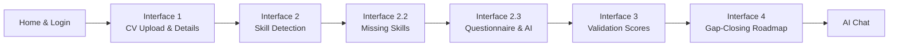

# Talyntra — Intelligent Career & CV Skill Validator

> **"Upload your CV. Discover your edge. Close your gaps."**

Talyntra is a premium, AI-powered React application that transforms how ambitious professionals understand, validate, and elevate their careers. It goes beyond passive resume parsing — analyzing your background against real-world tech benchmarks, detecting missing competencies, engaging you in a contextual career questionnaire & AI chatbot, generating a validated skill match score, and producing an actionable 4-phase gap-closing roadmap.

Built with **React 18**, **TypeScript**, and **Vite**. Powered by **Google Gemini AI** for real-time streaming career intelligence.

---

## 🌟 Features

### 🤖 Real-Time AI Integration
- **Google Gemini 2.0 Flash** streaming responses for live career guidance
- Token-by-token streaming display (ChatGPT/Claude-style)
- Automatic fallback to intelligent offline mock responses when no API key is configured
- API key management with validation in Settings

### 🔐 User Authentication
- Register/Login with email and password
- Multi-user support with persistent sessions
- Demo account quick-start for instant access
- Session management with logout

### 📊 6-Interface Career Analysis Journey



### Interface Details

1. **CV Upload & Basic Details** (`/upload`) — Resume dropzone (PDF/DOCX) with animated parse simulation, 5-field profile form
2. **Skill Set Output** (`/skills`) — Category-filtered skills with animated proficiency bars, overall match percentage
3. **Missing Competencies** (`/skills?tab=missing`) — Priority-tiered gaps (Critical/Important/Nice-to-have) with learning difficulty ratings
4. **Questionnaire & AI Chatbot** (`/questionnaire`) — Split-screen 5-step wizard + real-time AI chatbot + benchmark job profile
5. **Validation Output** (`/validation`) — SVG circular gauge, 4-axis metric breakdown, strengths vs. concerns analysis
6. **Gap-Closing Roadmap** (`/roadmap`) — 4-phase timeline with interactive checklists, curated resources, PDF export
7. **Full AI Chat** (`/chat`) — Streaming conversational career assistant with suggestion chips
8. **Settings** (`/settings`) — API key management, account info, data reset

---

## 🎨 Design System

| Token | Value | Purpose |
|---|---|---|
| `--teal-1` | `#008f94` | Primary aurora radial stop |
| `--teal-2` | `#005e61` | Mid radial gradient |
| `--teal-3` | `#004548` | Deep radial gradient |
| `--teal-4` | `#002c2e` | Global page background |
| `--panel` | `#003136` | Sidebar & conversational panel |
| `--bubble` | `#003c3e` | AI message bubbles |
| `--indigo` | `#4f46e5` | Primary CTA button |
| `--accent-cyan` | `#7ef0ec` | Active indicators & highlights |
| `--serif` | `"Hanuman", Georgia, serif` | Headings & branding |
| `--sans` | `"Inter", system-ui, sans-serif` | Body text & UI labels |

Typography follows ChatGPT/Claude browser UI conventions: 14px base, 13px small, 15px medium.

---

## 🛠 Tech Stack

- **React 18** + **TypeScript** (Strict mode)
- **Vite** (Ultra-fast HMR and production builds)
- **React Router DOM v6** (Client-side routing with 10 routes)
- **Google Gemini AI** (`gemini-2.0-flash` via REST API with SSE streaming)
- **Zero External UI Libraries** — Handcrafted CSS with backdrop filters, SVG gauges, and animations

### Architecture

| Layer | Module | Purpose |
|---|---|---|
| AI Client | `src/lib/geminiAI.ts` | Real-time Gemini streaming, API key management, profile context builder |
| AI Fallback | `src/lib/mockAI.ts` | Offline heuristic engine with role-aware skill/gap/roadmap generation |
| Auth | `src/lib/auth.ts` | LocalStorage-based register/login/logout with session persistence |
| State | `src/lib/store.tsx` | React Context + localStorage persistence, AI status tracking |
| Components | `src/components/` | Aurora, Button, Logo, Sidebar (with ESC navigation, logout, settings) |
| Pages | `src/pages/` | 9 pages covering the full career analysis journey |

---

## 🚀 Getting Started

### 1. Install dependencies
```bash
npm install
```

### 2. Run local development server
```bash
npm run dev
```
Open [http://localhost:5173](http://localhost:5173) in your browser.

### 3. (Optional) Connect Gemini AI
1. Go to [aistudio.google.com/apikey](https://aistudio.google.com/apikey)
2. Sign in and create an API key
3. In the app, navigate to **Settings** (⚙️) and paste your key
4. Click **Save & Verify** — the app will validate and enable live AI

Without an API key, the app operates in full offline demo mode with intelligent pre-generated responses.

### 4. Production Build
```bash
npm run build
```

---

## 📂 Project Structure

```
Talyntra/
├── public/                  # Favicons and static assets
├── docs/
│   ├── ARCHITECTURE.md      # Technical architecture & data flow
│   └── INTERFACES.md        # Per-screen specification
├── src/
│   ├── components/
│   │   ├── Aurora.tsx        # Breathing diamond-radial teal background
│   │   ├── Button.tsx        # Indigo / Deep / Glass button variants
│   │   ├── Logo.tsx          # Branded logo with fallback SVG
│   │   └── Sidebar.tsx       # Navigation sidebar (8 items + logout + settings)
│   ├── lib/
│   │   ├── geminiAI.ts       # Gemini API client (streaming + non-streaming)
│   │   ├── mockAI.ts         # Offline AI heuristic engine
│   │   ├── auth.ts           # Authentication system
│   │   └── store.tsx         # Global state with Context + localStorage
│   ├── pages/
│   │   ├── Home.tsx          # Landing page
│   │   ├── Login.tsx         # Auth portal (register/login)
│   │   ├── Upload.tsx        # Interface 1: CV dropzone & details
│   │   ├── Skills.tsx        # Interface 2 & 2.2: Detected & missing skills
│   │   ├── Questionnaire.tsx # Interface 2.3: Quiz + chatbot split
│   │   ├── Validation.tsx    # Interface 3: Gauge & breakdown
│   │   ├── Roadmap.tsx       # Interface 4: Timeline & resources
│   │   ├── Chat.tsx          # Full AI conversational assistant
│   │   └── Settings.tsx      # API key, account & preferences
│   ├── App.tsx               # Route definitions
│   ├── main.tsx              # Bootstrap & StoreProvider
│   └── styles.css            # Complete design system
├── .gitignore
├── CHANGELOG.md
└── README.md
```

---

## ⌨️ Keyboard Shortcuts

| Key | Context | Action |
|---|---|---|
| `Enter` | Home page | Navigate to login |
| `Enter` | Login form | Submit login/register |
| `Enter` | Chat/Questionnaire | Send message |
| `ESC` | Any page with sidebar | Navigate back |
| `ESC` | Questionnaire | Go back one step or return to skills |
| `ESC` | Login | Return to home |

---

## 📄 License
MIT © Talyntra Team
