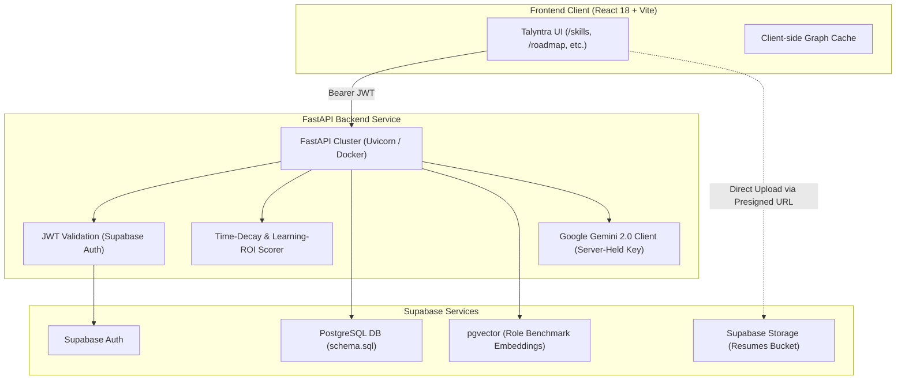

# Talyntra Backend Migration Architecture

This directory contains the production-ready **FastAPI** service and **Supabase (PostgreSQL + pgvector)** data schema for Talyntra's **Skill-Evidence Engine**.

---

## 🏛 System Architecture



---

## 🔒 Zero-Browser-Key Security Model

In the prototype, Gemini API keys were temporarily saved in `localStorage`. In this target architecture:
1. **API Keys are Server-Only**: `GEMINI_API_KEY` is loaded exclusively into FastAPI server environment variables.
2. **Authenticated SSE Streaming**: The browser connects to `POST /api/v1/chat/stream` with a Supabase JWT. FastAPI handles streaming tokens from Gemini to the client over Server-Sent Events.
3. **Presigned Uploads**: Resumes are uploaded directly to Supabase Storage via presigned PUT URLs, preventing raw PDF binary overload on the application server.

---

## 📂 Directory Structure

```
backend/
├── app/
│   ├── main.py              # FastAPI application & endpoints
│   ├── routers/             # Modular endpoint routers
│   ├── services/            # LLM parser & evidence extraction
│   └── config.py            # Environment & security config
├── database/
│   └── schema.sql           # Complete Supabase PostgreSQL + pgvector DDL
├── requirements.txt         # Python dependencies
└── README.md                # This migration guide
```

---

## 🗄 Database Setup (Supabase)

1. Open your **Supabase Dashboard** or run locally with the Supabase CLI (`supabase start`).
2. Go to the **SQL Editor** and execute `backend/database/schema.sql`.
3. The schema creates:
   - `profiles`: Linked to `auth.users(id)` with Row-Level Security (RLS).
   - `evidence_nodes`: Atomic citations with `base_weight`, dates, and `verified` flags.
   - `skill_claims`: Recency half-life calculations, confidence scores, and status (`verified`, `moderate`, `weak`, `insufficient_evidence`).
   - `skill_evidence_links`: Many-to-many relationship linking claims to evidence.
   - `role_benchmarks`: Benchmarks with `vector(768)` embeddings for semantic matching.
   - `user_skill_gaps`: Missing competencies ranked by `roi_score` ($\text{roles unlocked} / \text{hour}$).
   - `user_roadmap_tasks`: Milestones that auto-verify and feed back into the graph.

---

## 🚀 Running the FastAPI Service

### 1. Create a virtual environment & install dependencies
```bash
python -m venv venv
# On Windows:
.\venv\Scripts\activate
# On Linux/macOS:
source venv/bin/activate

pip install -r requirements.txt
```

### 2. Set environment variables (`.env`)
```env
GEMINI_API_KEY=your_gemini_api_key_here
SUPABASE_URL=https://your-project.supabase.co
SUPABASE_SERVICE_ROLE_KEY=your_service_role_key
ALLOWED_ORIGINS=http://localhost:5173,http://localhost:4173
```

### 3. Start development server
```bash
uvicorn app.main:app --reload --port 8000
```

Access interactive Swagger docs at: [http://localhost:8000/docs](http://localhost:8000/docs)

