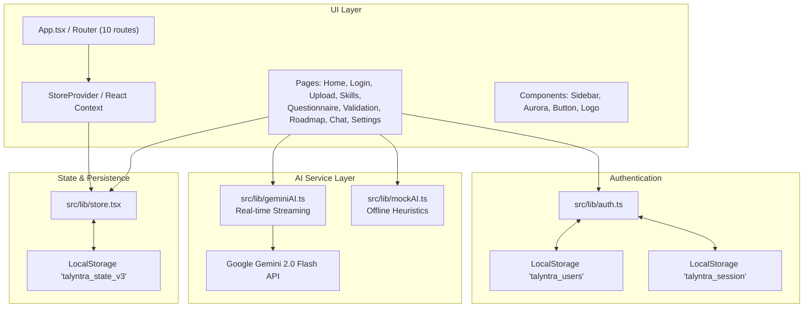
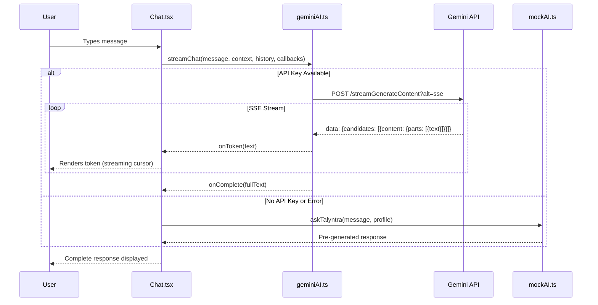
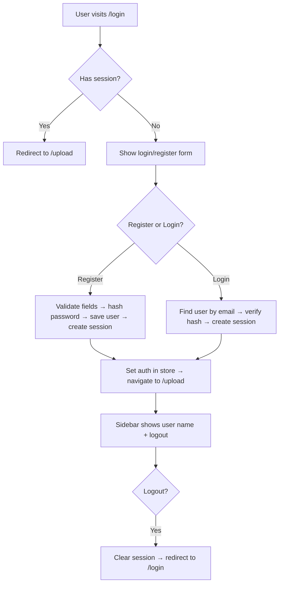

# Talyntra Technical Architecture

This document provides a comprehensive breakdown of the technical design, state flow, component hierarchy, AI integration, and authentication patterns powering Talyntra.

---

## 1. High-Level Architecture Overview

Talyntra is a client-side SPA with dual AI backends — a real-time Google Gemini streaming client and an offline heuristic mock engine. The architecture cleanly separates concerns so that backend services can be swapped independently.



---

## 2. AI Integration Architecture

### Gemini Streaming Client (`src/lib/geminiAI.ts`)

The AI client connects to Google Gemini 2.0 Flash via REST API with Server-Sent Events (SSE) for real-time token streaming.



### Key AI Functions

| Function | Purpose | Mode |
|---|---|---|
| `streamChat()` | Real-time streaming conversation | Online |
| `generateContent()` | Single-shot non-streaming analysis | Online |
| `buildProfileContext()` | Serializes user profile for AI context | Both |
| `validateApiKey()` | Tests API key validity with minimal request | Online |
| `askTalyntra()` | Role-aware offline career responses | Offline |
| `analyzeCV()` | Heuristic skill extraction from profile data | Offline |
| `generateValidation()` | Score calculation and gap analysis | Offline |
| `generateRoadmap()` | 4-phase career roadmap generation | Offline |

### Conversation Context Architecture

Every Gemini API call injects a structured context:
1. **System prompt** (career coach persona with 6 capabilities)
2. **Profile context** (name, role, experience, detected/missing skills)
3. **Conversation history** (full multi-turn `GeminiMessage[]` array)
4. **Current user message**

This ensures the AI always responds with awareness of the candidate's complete profile.

---

## 3. Authentication System (`src/lib/auth.ts`)

### Flow



### Storage Keys

| Key | Data | Purpose |
|---|---|---|
| `talyntra_users` | `AuthUser[]` | All registered accounts |
| `talyntra_session` | `AuthSession` | Current active session |
| `talyntra_state_v3` | `TalyntraState` | App state (profile, skills, validation, etc.) |
| `talyntra_gemini_key` | `string` | Encrypted Gemini API key |

---

## 4. Global State Store (`src/lib/store.tsx`)

The application state is managed using a centralized React Context with automatic synchronization to browser `localStorage`.

### State Model
```typescript
interface TalyntraState {
  profile: Profile;                       // Name, target role, experience, location, LinkedIn
  cvFile: { name: string; size: number } | null;
  cvParsing: boolean;                     // Scanning state for dropzone
  cvParsed: boolean;                      // True once successfully processed
  skills: SkillAnalysis | null;           // Detected skills, missing competencies & match score
  questionnaire: QuestionnaireAnswer[];   // Answers to the 5 calibration questions
  validation: ValidationResult | null;    // Overall score, 4-axis metrics, strengths/concerns
  roadmap: RoadmapPhase[] | null;         // 4-phase timeline with interactive task checklists
  auth: AuthSession | null;               // Current authenticated user session
  aiConnected: boolean;                   // Whether Gemini API key is configured
}
```

### Store Capabilities
- **`setProfile(p)`** — Updates user credentials across all views
- **`setSkills(skills)`** — Stores extracted skills and gap analysis
- **`addQuestionnaireAnswer(ans)`** — Appends or updates question responses
- **`toggleRoadmapAction(phaseNum, actionId)`** — Toggles checklist items and updates progress
- **`setAuth(session)`** — Sets or clears authenticated session
- **`refreshAiStatus()`** — Re-checks Gemini API key presence and updates `aiConnected`
- **`resetAll()`** — Flushes cache and reinitializes with pristine defaults

---

## 5. UI Component Hierarchy

### The Diamond Aurora Effect (`Aurora.tsx`)
```css
.aurora__glow {
  background: radial-gradient(ellipse 52% 70% at 50% 50%, #008f94 0%, #005e61 38%, #004548 62%, transparent 100%);
  clip-path: polygon(50% 0, 100% 50%, 50% 100%, 0 50%);
  filter: blur(60px);
  animation: breathe 9s ease-in-out infinite alternate;
}
```

### Sidebar (`Sidebar.tsx`)
- 8 navigation items with inline SVG icons
- Settings gear icon route
- Active route highlighting with cyan left border accent
- AI connection status dot (green = live Gemini, gray = offline)
- ESC key handler for back navigation
- Logout button
- Candidate identity footer (initials avatar, name, target role)

---

## 6. Real Backend Transition Guide

To connect Talyntra to a production backend:

| Current Mock | Production Replacement |
|---|---|
| `analyzeCV()` | `POST /api/cv/analyze` (multipart file upload) |
| `generateValidation()` | `POST /api/skills/validate` (profile + questionnaire) |
| `generateRoadmap()` | `POST /api/roadmap/generate` (streaming) |
| `askTalyntra()` | Already uses Gemini; add WebSocket for persistence |
| `auth.ts` (localStorage) | `POST /api/auth/login`, JWT tokens, OAuth providers |
| `store.tsx` (localStorage) | Server-side state with API sync |

---

## 7. Security & Privacy

- **No remote telemetry**: State is kept purely local in `localStorage`
- **API key storage**: Gemini key stored in `localStorage` (client-side only; not transmitted to any third-party)
- **Password hashing**: Client-side hash for demo auth (should use bcrypt + server-side for production)
- **Sanitized inputs**: Form fields and chat messages bound to controlled React state
- **No third-party trackers**: Zero analytics or tracking cookies
